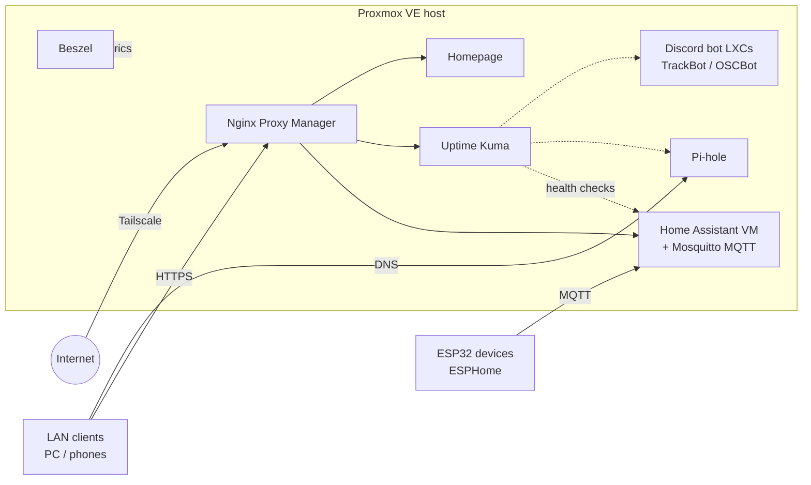

# Homelab

A self-hosted home server built from a retired desktop PC running **Proxmox VE**. It's the hub for my smart home, DNS, monitoring, and the Discord bots and hardware projects I build on the side.

## Hardware

| Part | Detail |
|---|---|
| Motherboard | Asus Z97-A/USB 3.1 (LGA1150) |
| Storage | 512 GB NVMe + 1 TB SATA SSD (extra Proxmox storage / backup target) |
| Case | Apevia X-Dreamer4 ATX mid tower |
| Network | TP-Link Deco mesh |
| Remote access | Tailscale (no port forwards needed) |

## What's running

| Service | Runs as | What it does |
|---|---|---|
| **Home Assistant** | VM | Smart-home brain. Controls Govee lights (home/away automation on phone presence) and ESPHome devices. |
| ↳ Mosquitto | HA add-on | MQTT broker for ESP32 devices. |
| ↳ ESPHome | HA add-on | Builds and OTA-flashes ESP32 firmware (e.g. the Talking Wall Bass). |
| **Pi-hole** | Proxmox guest | Network-wide DNS and ad/tracker blocking for LAN clients. |
| **Nginx Proxy Manager** | Proxmox guest | Reverse proxy; gives each service a friendly hostname with TLS. |
| **Homepage** | Proxmox guest | Dashboard with live widgets for every service. |
| **Portainer** | Docker LXC | Manages Docker stacks on the host. |
| **Uptime Kuma** | Docker stack (Portainer) | Uptime checks for every service. |
| **Beszel** | Docker stack (Portainer) | Host and container resource metrics (CPU, RAM, disk, network). |
| **TrackBot** | LXC (systemd + git clone) | Discord bot: weekly git/Todoist digests and game-night pings. |
| **OSCBot** | LXC (systemd + git clone) | Discord bot for an Old School RuneScape clan: Wise Old Man stats, Dink drop tracking, team bingo. |

Host setup also includes the Proxmox community *PVE Post Install* and microcode scripts.

## Architecture

Remote traffic reaches the server over Tailscale, so the router doesn't need port forwards. On the LAN, Pi-hole answers DNS and Nginx Proxy Manager routes each hostname to the right service. ESP32 devices talk to Home Assistant over MQTT through the Mosquitto add-on.

## Security

**In place**
- Remote access goes through Tailscale, so nothing needs to be exposed to the internet to reach the lab from outside.
- Nginx Proxy Manager is the single entry point for web UIs, with TLS on each hostname.
- Pi-hole filters DNS for the whole network, blocking ads and trackers before devices connect to them.

**In progress**
- Confirm zero port forwards and UPnP off on the router, then verify with an outside scan of the public IP.
- TOTP 2FA and unique passwords (password manager) on every account: Proxmox, Home Assistant, Portainer, NPM, Pi-hole, GitHub, Cloudflare, Tailscale.
- Proxmox: separate non-root admin user, and the firewall limiting 8006/22 to the LAN and Tailscale range.
- Key-only SSH (`PasswordAuthentication no`) on the host and every LXC.
- IoT devices (Govee lights, ESP32s) moved onto their own isolated Wi-Fi network.

## Design notes

**Backups.** Proxmox's built-in backup job snapshots every VM and LXC weekly to the 1 TB SSD, keeping the last four. Bot code lives in git, so an LXC can also be rebuilt from scratch with a clone and a systemd unit.

**Monitoring.** Uptime Kuma checks that each service is reachable, and Beszel tracks resource usage on the host and containers so slow problems (a filling disk, a memory leak) show up before they cause an outage. Homepage pulls both into one dashboard.

**Alerting.** Uptime Kuma is the alert source: when a check fails it fires a notification instead of waiting for me to notice. It also doubles as the safety net for updates; after patching the host, LXCs or containers, anything that doesn't come back shows up as down.

## Problems I solved

- **NVMe on a 2014 motherboard.** The Z97-A didn't recognize the KingSpec NVMe drive at first, which blocked the initial Linux install. I worked through it, and that drive now runs in the server.
- **Uptime Kuma install failing.** The Proxmox community-script LXC install for Uptime Kuma failed. Instead of fighting it, I deployed Uptime Kuma (and later Beszel) as Docker stacks through Portainer, which made them easier to update and back up.
- **Motors vs. the microcontroller on one supply.** On the Talking Wall Bass, the ESP32 and two DC motors share a single 5V rail, and motor inrush current can sag it enough to brownout-reset the ESP32. I added a 1000 µF capacitor across 5V/GND next to the DRV8833 motor driver to buffer those spikes, and kept the motor driver off the ESP32's boot-strapping pins.
- **Lights without local control.** Only some of my Govee lights support LAN control and none expose Matter. I integrated them into Home Assistant through the Govee cloud API instead, which made a home/away automation possible: lights turn on when my phone rejoins home Wi-Fi and off when I leave.

## Roadmap

- [ ] Finish the security items above (2FA everywhere, key-only SSH, Proxmox firewall, IoT network)
- [ ] Tailscale ACLs so only my devices can reach admin UIs
- [ ] Encrypted upstream DNS for Pi-hole (Unbound or cloudflared)
- [ ] Update routine: `unattended-upgrades` on LXCs, monthly host and stack updates
- [ ] Connect more hardware projects to the hub (offline ADS-B plane tracker feed)
