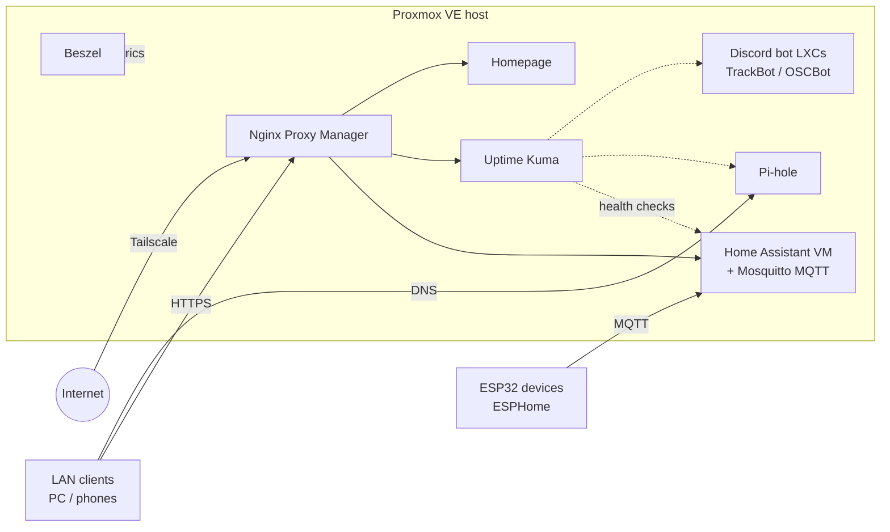

# Homelab

A self-hosted home server built from a retired desktop PC running **Proxmox VE**. It's the hub for my smart home, DNS, monitoring, and the Discord bots and hardware projects I build on the side.

## Hardware

| Part | Detail |
|---|---|
| Motherboard | Asus Z97-A/USB 3.1 (LGA1150) |
| Storage | 512 GB NVMe + 1 TB SATA SSD (extra Proxmox storage / backup target) |
| Case | Apevia X-Dreamer4 ATX mid tower |
| Network | TP-Link Deco mesh |
| Remote access | Tailscale (no port forwards) |

## What's running

| Service | Runs as | What it does |
|---|---|---|
| **Home Assistant** | VM | Smart-home brain. Controls Govee lights (home/away automation on phone presence) and ESPHome devices. |
| ↳ Mosquitto | HA add-on | MQTT broker for ESP32 devices. |
| ↳ ESPHome | HA add-on | Builds and OTA-flashes ESP32 firmware (e.g. the Talking Wall Bass). |
| **Pi-hole** | Proxmox guest | Network-wide DNS and ad/tracker blocking for LAN clients. |
| **Nginx Proxy Manager** | Proxmox guest | Reverse proxy; gives each service a friendly hostname with TLS. |
| **Homepage** | Proxmox guest | Dashboard with live widgets for every service. |
| **Portainer** | Docker LXC | Manages Docker stacks on the host. |
| **Uptime Kuma** | Docker stack (Portainer) | Uptime checks for every service. |
| **Beszel** | Docker stack (Portainer) | Host and container resource metrics (CPU, RAM, disk, network). |
| **TrackBot** | LXC (systemd + git clone) | Discord bot: weekly git/Todoist digests and game-night pings. |
| **OSCBot** | LXC (systemd + git clone) | Discord bot for an Old School RuneScape clan: Wise Old Man stats, Dink drop tracking, team bingo. |

Host setup also includes the Proxmox community *PVE Post Install* and microcode scripts.

## Architecture

Remote traffic only reaches the server over Tailscale; the router has no port forwards. On the LAN, Pi-hole answers DNS and Nginx Proxy Manager routes each hostname to the right service. ESP32 devices talk to Home Assistant over MQTT through the Mosquitto add-on.

## Design notes

**Backups.** Proxmox's built-in backup job snapshots every VM and LXC weekly to the 1 TB SSD, keeping the last four, with a test restore of one LXC to prove the backups actually work. Bot code lives in git, so an LXC can also be rebuilt from scratch with a clone and a systemd unit. *(Status: being set up.)*

**Monitoring.** Uptime Kuma checks that each service is reachable, and Beszel tracks resource usage on the host and containers so slow problems (a filling disk, a memory leak) show up before they cause an outage. Homepage pulls both into one dashboard.

**Alerting.** Uptime Kuma is the alert source: when a check fails it fires a notification instead of waiting for me to notice. It also doubles as the safety net for updates; after patching the host, LXCs or containers, anything that doesn't come back shows up as down.
