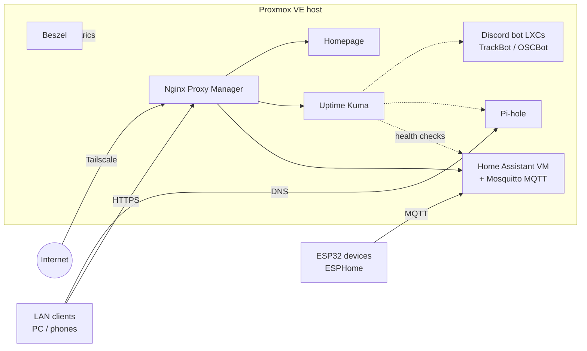

# Homelab

A self-hosted home server built from a retired desktop PC running **Proxmox VE**. It's the hub for my smart home, DNS, monitoring, and the Discord bots and hardware projects I build on the side.

## Hardware

| Part | Detail |
|---|---|
| Motherboard | Asus Z97-A/USB 3.1 (LGA1150) |
| Storage | 512 GB NVMe (Proxmox + all guests) · 1 TB SATA SSD (backups) |
| Case | Apevia X-Dreamer4 ATX mid tower |
| Network | TP-Link Deco mesh |
| Remote access | Tailscale (no port forwards needed) |

## What's running

| Service | Runs as | What it does |
|---|---|---|
| **Home Assistant** | VM | Smart-home brain. Controls Govee lights (home/away automation on phone presence) and ESPHome devices. |
| ↳ Mosquitto | HA add-on | MQTT broker for ESP32 devices. |
| ↳ ESPHome | HA add-on | Builds and OTA-flashes ESP32 firmware (e.g. the Talking Wall Bass). |
| **Pi-hole** | Proxmox guest | Network-wide DNS and ad/tracker blocking for LAN clients. |
| **Nginx Proxy Manager** | Proxmox guest | Reverse proxy; gives each service a friendly hostname with TLS. |
| **Homepage** | Docker stack (Portainer) | Dashboard with live widgets for every service, themed and deployed from [`homepage/`](homepage/) in this repo. |
| **Portainer** | Docker LXC | Manages Docker stacks on the host. |
| **Uptime Kuma** | Docker stack (Portainer) | Uptime checks for every service. |
| **Beszel** | Docker stack (Portainer) | Host and container resource metrics (CPU, RAM, disk, network). |
| **TrackBot** | LXC (systemd + git clone) | Discord bot: weekly git/Todoist digests and game-night pings. |
| **OSCBot** | LXC (systemd + git clone) | Discord bot for an Old School RuneScape clan: rank-up commands, team bingo with live board images, and Dink drop tracking. |
| **PostgreSQL** | LXC | Shared database server for the apps: one database and one user per app (see [Postgres](#postgres-one-database-and-one-user-per-app)). |

Host setup also includes the Proxmox community *PVE Post Install* and microcode scripts.

## Architecture



Remote traffic reaches the server over Tailscale, so the router doesn't need port forwards. On the LAN, Pi-hole answers DNS and Nginx Proxy Manager routes each hostname to the right service. ESP32 devices talk to Home Assistant over MQTT through the Mosquitto add-on.

## Security

**In place**
- Remote access goes through Tailscale, so nothing needs to be exposed to the internet to reach the lab from outside.
- Nginx Proxy Manager is the single entry point for web UIs, with TLS on each hostname.
- Pi-hole filters DNS for the whole network, blocking ads and trackers before devices connect to them.
- Pi-hole resolves recursively through a local Unbound instance with DNSSEC validation, so DNS queries aren't handed to a public upstream resolver.
- UPnP is off and there are no port forwards on the router; an outside check of the public IP shows nothing exposed.
- Unique passwords in a password manager, with TOTP 2FA on the important accounts.

## Postgres: one database and one user per app

Every app gets its own login role and its own database, owned by that role. No app uses the `postgres` superuser, and no app can see another app's data.

| Thing | Rule |
|---|---|
| Role | Same name as the app, `LOGIN`, no superuser, no create-db, no create-role |
| Database | Same name as the app, `OWNER` = that role |
| Who can connect | Only that role (`CONNECT` revoked from `PUBLIC`) |
| From where | One `pg_hba.conf` line per app container, `scram-sha-256` |
| Password | Random, stored in a password manager and the app's `.env` only |
| Backups | One nightly `pg_dump` file per database |

Placeholders: `<app>` app/role/database name (lowercase, letters, digits, `_`), `<pg_host>` the Postgres server address, `<app_host>` the app container's address. Examples below use `exampleapp`.

### 1. Generate a password

```bash
openssl rand -hex 32
```

Hex (0-9, a-f) has no characters that need escaping in a URL, a shell or a config file. 64 hex characters is plenty. Save it in the password manager before going on.

### 2. Create the role and database

Run on the Postgres server as the `postgres` OS user (local socket, no password needed):

```bash
sudo -u postgres psql
```

```sql
CREATE ROLE exampleapp LOGIN NOSUPERUSER NOCREATEDB NOCREATEROLE NOREPLICATION CONNECTION LIMIT 20;
\password exampleapp
CREATE DATABASE exampleapp OWNER exampleapp ENCODING 'UTF8';
REVOKE CONNECT ON DATABASE exampleapp FROM PUBLIC;
GRANT  CONNECT ON DATABASE exampleapp TO exampleapp;
\c exampleapp
REVOKE ALL ON SCHEMA public FROM PUBLIC;
ALTER SCHEMA public OWNER TO exampleapp;
\q
```

Why each line:
- `\password` prompts for the password and sends only a hash, so it never lands in shell or psql history. (`CREATE USER x WITH PASSWORD '...'` also works but leaves the password in `~/.psql_history`.)
- `REVOKE CONNECT ... FROM PUBLIC`: by default every role may connect to every database. This makes the database private to its owner.
- `schema public`: since Postgres 15 the `public` schema belongs to `pg_database_owner` and ordinary roles can no longer create tables in it. Making the app role its owner is explicit and lets the app's migrations create and alter tables. On Postgres 14 or older, the `REVOKE ALL ON SCHEMA public FROM PUBLIC` line is the important one.
- The app role owns its database, so migration tools (Alembic and so on) work without any server-level rights.

### 3. Allow the app's container in `pg_hba.conf`

One line per app, in `/etc/postgresql/<version>/main/pg_hba.conf`, above any final `reject` lines (first match wins):

```
# TYPE  DATABASE    USER        ADDRESS          METHOD
host    exampleapp  exampleapp  <app_host>/32    scram-sha-256
```

Then reload (no restart, no dropped connections):

```bash
sudo systemctl reload postgresql
```

- `/32` means exactly one address. Avoid whole-LAN ranges.
- Never `trust` or `md5`. `password_encryption = 'scram-sha-256'` should be set (it is the default since Postgres 14).
- If the server has a firewall, also allow `<app_host>` to TCP 5432.

### 4. Point the app at it

In the app's `.env` on its own container (never committed):

```
DATABASE_URL=postgresql://<app>:<password>@<pg_host>:5432/<app>
```

- SQLAlchemy needs the driver in the scheme: `postgresql+psycopg://` for psycopg 3, `postgresql+psycopg2://` for psycopg2, `postgresql+asyncpg://` for asyncpg.
- **URL-encode special characters in the password.** These break the URL: `@ : / ? # [ ] % & + = space`. Encode them as `%40 %3A %2F %3F %23 %5B %5D %25 %26 %2B %3D %20`. Encode in Python with:
  ```bash
  python3 -c 'import urllib.parse,getpass; print(urllib.parse.quote(getpass.getpass(), safe=""))'
  ```
  A hex password from step 1 never needs encoding.
- If the URL goes through Alembic's `config.set_main_option()`, a `%` must be doubled (`%%`), because that file uses Python's configparser. Another reason to use hex.

Test from the app container (prompts for the password):

```bash
psql "host=<pg_host> dbname=<app> user=<app>" -c "select current_user, current_database();"
psql "host=<pg_host> dbname=postgres user=<app>" -c "select 1;"   # must FAIL
```

### 5. Nightly backups, one file per database

Each database is dumped on its own, in custom format, with the date in the file name:

```bash
pg_dump --format=custom --file=<backup_dir>/<app>_$(date +%F_%H%M%S).dump <app>
```

- A read-only `backup` role with `pg_read_all_data` does the dumps. Because `CONNECT` is revoked from `PUBLIC`, each new database also needs `GRANT CONNECT ON DATABASE <app> TO backup;`.
- The backup user's password lives in its `~/.pgpass` (mode 600), not in the script or cron line.
- Cron runs it nightly; old dumps are pruned after N days; dumps are copied off the server.
- Dumps do not contain roles or passwords. A full restore recreates the role first (step 2), then `pg_restore`.
- A backup that has never been restored is not a backup. Restore into a scratch database once a month.

### Adding a new app (checklist)

- [ ] Pick the name `<app>` (lowercase, no dashes).
- [ ] `openssl rand -hex 32`, save it in the password manager.
- [ ] Step 2: role, `\password`, database, revoke/grant connect, schema owner.
- [ ] `GRANT CONNECT ON DATABASE <app> TO backup;`
- [ ] Step 3: one `pg_hba.conf` line for the app's container, reload.
- [ ] Firewall: allow `<app_host>` to 5432.
- [ ] Add `<app>` to the backup script's database list.
- [ ] Step 4: `DATABASE_URL` in the app's `.env`, then the two `psql` tests.
- [ ] Run the app's migrations, then check the next night's dump exists.

### Removing an app

1. Stop the app and remove `DATABASE_URL` from its `.env`.
2. Take a final dump and keep it somewhere safe:
   `pg_dump --format=custom --file=<backup_dir>/<app>_final_$(date +%F).dump <app>`
3. Delete the app's line from `pg_hba.conf` and `sudo systemctl reload postgresql`. Remove its firewall rule.
4. Remove `<app>` from the backup script's list.
5. Drop the database and role:
   ```sql
   SELECT pg_terminate_backend(pid) FROM pg_stat_activity WHERE datname = '<app>';
   DROP DATABASE <app>;
   -- In each OTHER database where the role might own or be granted something:
   -- REASSIGN OWNED BY <app> TO postgres; DROP OWNED BY <app>;
   DROP ROLE <app>;
   ```
   `DROP ROLE` fails while the role still owns objects or holds grants anywhere; the `REASSIGN OWNED` / `DROP OWNED` pair clears them. If the role only ever touched its own database, dropping that database is usually enough.
6. Delete the password from the password manager after the final dump has been test-restored once.

## Design notes

**Backups.** Storage is split by role: every VM and LXC runs on the NVMe (`local-lvm`), and backups go to the 1 TB SSD, so a single drive failure can't take out both a guest and its backup. A weekly Proxmox backup job (Sunday 1:00 AM, snapshot mode, keep last 7) covers all guests and writes to a dedicated ext4 volume carved from the SSD's LVM-thin pool, since LVM-thin can't store backup files directly. "Repeat missed" is on, so a run skipped during a power outage catches up at the next boot. Bot code also lives in git, so an LXC can be rebuilt from scratch with a clone and a systemd unit.

**Monitoring.** Uptime Kuma checks that each service is reachable, and Beszel tracks resource usage on the host and containers so slow problems (a filling disk, a memory leak) show up before they cause an outage. Homepage pulls both into one dashboard.

**Alerting.** Uptime Kuma is the alert source: when a check fails it fires a notification instead of waiting for me to notice. It also doubles as the safety net for updates; after patching the host, LXCs or containers, anything that doesn't come back shows up as down.

## Problems I solved

- **A silently missed backup.** After a ~42-hour power outage, I noticed the newest backups were two weeks old. `journalctl --list-boots` showed the server was off when the weekly job was due, and Proxmox skips missed runs by default. Digging in also showed the backups were landing on the same NVMe as most of the guests. I enabled "Repeat missed," moved the two guests living on the SSD (Docker and Home Assistant, including its EFI disk) onto the NVMe, and turned part of the SSD's thin pool into dedicated backup storage. Now guests and backups always sit on different drives.

- **NVMe on a 2014 motherboard.** The Z97-A didn't recognize the KingSpec NVMe drive at first, which blocked the initial Linux install. I worked through it, and that drive now runs in the server.
- **Uptime Kuma install failing.** The Proxmox community-script LXC install for Uptime Kuma failed. Instead of fighting it, I deployed Uptime Kuma (and later Beszel) as Docker stacks through Portainer, which made them easier to update and back up.
- **Motors vs. the microcontroller on one supply.** On the Talking Wall Bass, the ESP32 and two DC motors share a single 5V rail, and motor inrush current can sag it enough to brownout-reset the ESP32. I added a 1000 µF capacitor across 5V/GND next to the DRV8833 motor driver to buffer those spikes, and kept the motor driver off the ESP32's boot-strapping pins.
- **Lights without local control.** Only some of my Govee lights support LAN control and none expose Matter. I integrated them into Home Assistant through the Govee cloud API instead, which made a home/away automation possible: lights turn on when my phone rejoins home Wi-Fi and off when I leave.

## Roadmap

- [x] Local recursive DNS for Pi-hole (Unbound)
- [x] Password manager and 2FA on the important accounts
- [ ] Keep hardening the lab (ongoing)
- [ ] Formalize the update routine for the host, LXCs and containers
- [ ] Connect more hardware projects to the hub (offline ADS-B plane tracker feed)
